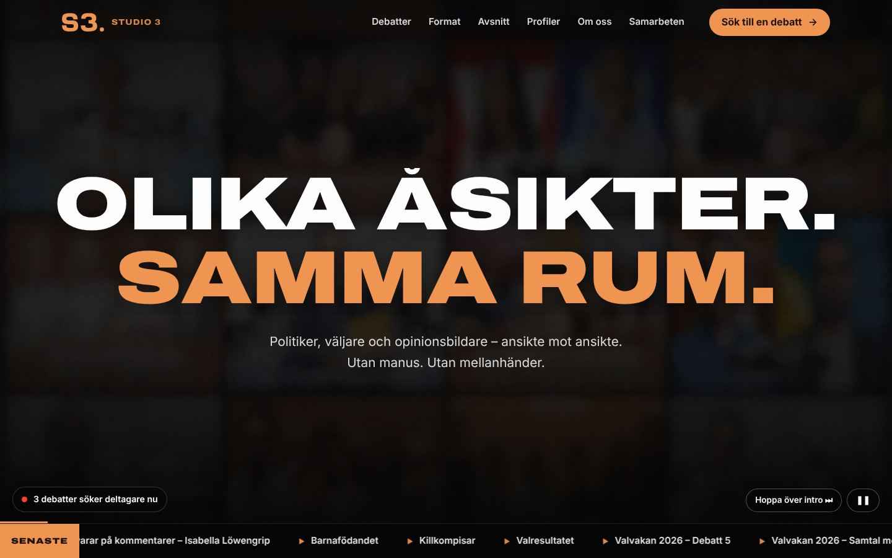
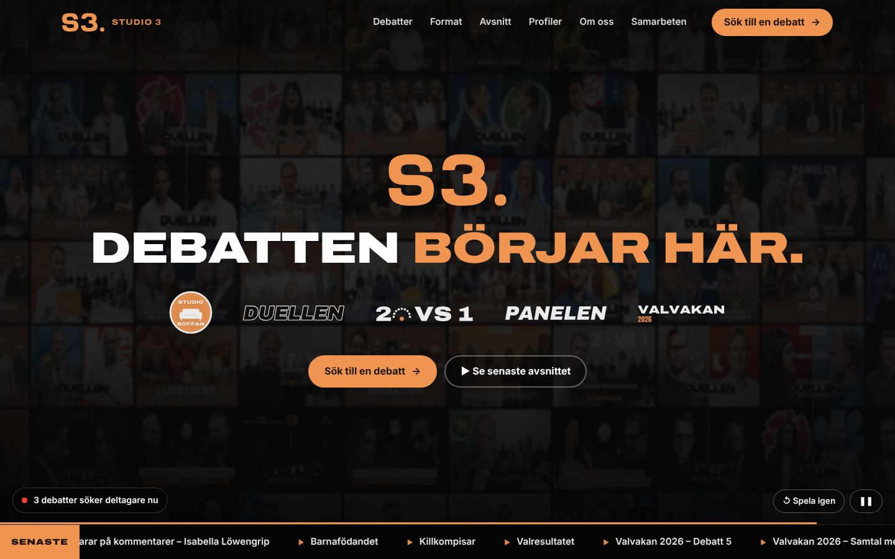

# STUDIO 3 – webbplats, ansökningssystem och admin

**Olika åsikter. Samma rum. Debatten börjar här.**

Komplett webbplats för YouTube-kanalen [STUDIO 3](https://www.youtube.com/@studio3-se): en hero med slogan och ihopklippt debattvideo, öppna debatter som folk kan söka till, en adminpanel där redaktionen publicerar debatter och castar deltagare, nyhetsbrev, partnerförfrågningar och **20 färdiga stilpaket**.




Fler bilder finns i [`docs/screenshots/`](docs/screenshots/). All information som samlats in om kanalen finns i [`docs/KANALEN.md`](docs/KANALEN.md), och de 20 stilpaketen beskrivs i [`docs/STILPAKET.md`](docs/STILPAKET.md).

## Se demon direkt i webbläsaren (githack)

En statisk förhandsvisning ligger i [`demo/`](demo/) och kan öppnas utan server:

- **Startsida:** https://raw.githack.com/ElevateStudio018/Studio-3/claude/pensive-pascal-73j87n/demo/index.html
- **Ansökan:** https://raw.githack.com/ElevateStudio018/Studio-3/claude/pensive-pascal-73j87n/demo/sok-partiledare-vs-20-valjare.html
- **20 stilpaket:** https://raw.githack.com/ElevateStudio018/Studio-3/claude/pensive-pascal-73j87n/demo/stilpaket.html
- **Admin (fiktiv demodata):** https://raw.githack.com/ElevateStudio018/Studio-3/claude/pensive-pascal-73j87n/demo/admin.html

I demon sparas inga formulär och admin visar påhittade ansökningar – ändringar försvinner när sidan laddas om. Bygg om den efter ändringar med `npm run build:demo`.

---

## Kom igång

Kräver **Node.js 22.13 eller senare**. Projektet har inga npm-beroenden (databasen är Nodes inbyggda SQLite), så `npm install` behövs inte.

```bash
cp .env.example .env        # sätt minst ADMIN_PASSWORD
npm start                   # http://localhost:3000
```

- Sajten: <http://localhost:3000>
- Admin: <http://localhost:3000/admin> (inloggning med `ADMIN_EMAIL` och `ADMIN_PASSWORD`; utan lösenord skapas ett slumpat lösenord som skrivs ut i terminalen och sparas i `data/FORSTA-INLOGGNING.txt`)
- Stilpaketen: <http://localhost:3000/stilpaket>

Vill du visa upp adminpanelen med innehåll? `npm run seed:demo` skapar 140 **fiktiva** ansökningar, prenumeranter och förfrågningar (taggade `demo`). Ta bort dem med `npm run seed:demo -- --rensa`.

Tester: `npm test` (18 integrationstester som startar servern mot en tom databas).

---

## Startsidan

| Del | Innehåll |
|---|---|
| **Hero** | Sekvens i tre steg: sloganen *”Olika åsikter. Samma rum.”* → ett hetsigt montage av **riktiga klipp ur avsnitten** (YouTubes *Mest uppspelade*-ögonblick) → slutkortet *”Debatten börjar här.”* med S3-loggan och formatloggorna (Studio Soffan, Duellen, 20 VS 1, Panelen, Valvakan). Därefter loopar videon tonat i bakgrunden. Knappar för att hoppa över, spela igen och pausa. Nyhetsrad med senaste avsnitten och en ”live”-etikett när debatter söker deltagare. |
| **Siffror** | 103 000 prenumeranter · 19,7 mn visningar · 725 videor · 1 000 000 visningar på största debatten (räknas upp när de syns). |
| **Öppna debatter** | Kort för varje debatt med påstående, inspelningsdatum, plats, nedräkning till sista ansökningsdag och vilka grupper som söks. Utvalda debatter visas stort. Talangbanken för den som inte hittar något. |
| **Så går det till + FAQ** | Fyra steg från ansökan till publicering och vanliga frågor (ersättning, ålder, GDPR …). |
| **Format** | 1 mot 20, Studio Soffan, Duellen, Partiledare vs 20 väljare, Panelen, Valvakan och Studio Banditer – med logga, antal avsnitt, visningar, länk till mest sedda avsnittet och spellistan. |
| **Avsnitt** | Alla 71 långa videor: senaste/mest sedda, filter per format, sök på ämne, person eller parti. Spelas i en modal (youtube-nocookie) och varje video har en direktlänk till YouTube. |
| **Profiler** | 87 politiker, debattörer och opinionsbildare som medverkat (avlästa från titlar och thumbnails). Klicka på en person för att se och länka till deras avsnitt. |
| **Om oss** | Historien, *Varför vi gör det här*, teamet (Simon Claesson, Emil Widén, Oliver Kastell) och citat från DN/Sveriges Radio. |
| **Press** | Bannerns YouTube-kommentar och artiklar i Sveriges Radio, DN/Pressen, Blankspot och Nyheter24. |
| **Samarbeten** | Säljsida för sponsring, livedebatter, föreläsningar och egna debattserier, med kanalens siffror och ett förfrågningsformulär. |
| **Nyhetsbrev** | Prenumeration med val (nya debatter att söka till / nya avsnitt / livedebatter & publikplatser) och län. Dubbel bekräftelse. |

## Allt på en sida

Hela sajten ligger på startsidan. Menyn scrollar till sektionerna och inget leder bort från sidan:

| Sektion | Innehåll |
|---|---|
| Debatter | Alla öppna, kommande och publicerade debatter samt talangbanken. *Sök nu* öppnar ansökan som ett lager ovanpå sidan. |
| Så går det till | Fyra steg och vanliga frågor. |
| Format | Formatkort och jämförelsetabell. Ett klick öppnar formatet med regler, siffror, alla avsnitt, medverkande och öppna debatter. |
| Avsnitt | Alla 71 avsnitt med sök, formatfilter och sortering. Spelaren öppnas ovanpå sidan med de hetaste ögonblicken (*Mest uppspelade*), medverkande och fler avsnitt. |
| Profiler | Alla 87 med sök, partifilter och sortering. Ett klick visar personens avsnitt och vilka hen debatterat mot. |
| Om oss | Historia, tidslinje, värderingar, team och citat. |
| Press | Faktablad, pressklipp, nedladdningsbara loggor och färger. |
| Samarbeten | Erbjudanden, siffror, exemplet Stortorget i Örebro, processen och förfrågningsformulär. |
| Nyhetsbrev och Kontakt | Prenumeration och kontaktvägar. |

Undersidorna (`/format/<format>`, `/avsnitt/<id>`, `/profiler/<namn>` m.fl.) finns kvar på servern som direktlänkar för Google och delning. De står i `sitemap.xml` men länkas inte från sidan.

## Ansökan (`/sok/<debatt>` och talangbanken `/sok`)

Fyra steg med förloppsindikator, validering per steg och **autosparat utkast** i webbläsaren:

1. **Om dig** – namn, e-post, mobil, födelseår (18+), ort, län, sysselsättning, kön (valfritt).
2. **Politik** – partisympati (alla riksdagspartier + annat/osäker/vill inte uppge), medlemskap, politiskt uppdrag (kommun/region/riksdag/EU/parti), organisationer, en **dragbar politisk kompass** (vänster–höger × GAL–TAN), ståndpunkt på debattens påstående (helt emot → helt för) och vilken målgrupp man söker till – som **föreslås automatiskt** utifrån parti och ståndpunkt.
3. **Din röst** – motivering, starkaste argument, vad som kan få en att ändra sig, debattens egna frågor, medieerfarenhet, sociala medier, videolänk och bild (förminskas i webbläsaren).
4. **Skicka** – tillgänglighet, separata samtycken (18+, **uttryckligt samtycke för politiska åsikter enligt GDPR art. 9**, filmning), nyhetsbrev, sammanfattning.

Efteråt: referensnummer (t.ex. `S3-260141`), bekräftelsemejl och delningsknapp. Debatter med publikplatser får ett kortare formulär för publik.

## Admin (`/admin`)

| Vy | Funktioner |
|---|---|
| **Översikt** | Nyckeltal, ansökningar per dag (30 dagar), partisympati bland sökande, **konverteringstratt** (besök → påbörjad → skickad), öppna debatter med målgruppsmätare, senaste ansökningar. |
| **Debatter** | Skapa från **mallar** (1 mot 20, Studio Soffan, Duellen, Partiledare, Panelen, Publik), status (utkast → öppen → stängd → inspelad → publicerad), utvald på startsidan, målgrupper med antal/partier/ståndpunkt, egna frågor (text, lista, ja/nej), publikplatser, omslagsbild från kanalens thumbnails, duplicera, och **mejla prenumeranter** när debatten öppnar. Stänger automatiskt efter sista ansökningsdag. |
| **Ansökningar** | Filter (debatt, status, parti, län, ålder, typ, fritext), sortering på **matchningspoäng**/betyg, statusflikar, **dubblettvarning** (samma e-post/telefon), massåtgärder (status, tagg, inbjudan, ”nej tack”, radera), CSV-export för Excel. Detaljpanel med allt som fyllts i, bild, kompass, stjärnbetyg, taggar, interna anteckningar, mejlmallar, flytta mellan debatter, historik och GDPR-radering. |
| **Casting-tavla** | Kanban per debatt (Ny → Granskad → Shortlist → Intervju → Uttagen → Bekräftad / Reserv / Nej tack) med drag och släpp, mätare för hur många som är valda per målgrupp och en **kompass** som visar den politiska spridningen så att panelen blir balanserad. |
| **Nyhetsbrev** | Segment (alla, nya debatter, nya avsnitt, event), länsfilter, testutskick, utkast från senaste videorna, historik, prenumerantlista och export. |
| **Videor** | Synkas automatiskt från YouTube (RSS var 30:e minut). Byt visningstitel, format och medverkande, fäst eller dölj videor. Valfritt automatiskt mejl till prenumeranter vid nytt avsnitt. |
| **Förfrågningar** | Partner- och eventförfrågningar som säljpipeline: status, värde i kronor, anteckningar, export. |
| **Innehåll & stil** | Välj bland de 20 stilpaketen, ändra slogan, slutkort, toppnotis, hero-video och tider, Om oss, team, steg, FAQ, partnertexter, sociala länkar, Swish-nummer och kanalstatistik – utan att röra koden. |
| **Utkorg** | Alla mejl systemet skickat, med förhandsvisning. |
| **Inställningar** | Notismejl vid nya ansökningar, automatisk radering efter X månader, byt lösenord, fler användare (admin/redaktör), exporter. |

### Smarta funktioner som gör att ni kan ta mer betalt

- **Matchningspoäng** (0–100) som sorterar fram de bästa ansökningarna: motivering, bild/video, tillgänglighet, starka åsikter och om personen passar en målgrupp.
- **Balans-verktyg**: målgruppsmätare och politisk kompass per debatt – visa beställare att panelen är allsidig.
- **Konverteringstratt och statistik** utan cookies – bevis på räckvidd och engagemang i säljsamtal.
- **Säljsida + pipeline** för sponsring, livedebatter (som Stortorget i Örebro), föreläsningar och egna debattserier.
- **Segmenterade nyhetsbrev** per intresse och län – sälj lokala livedebatter och publikplatser.
- **Talangbank** – en egen databas med debattörer som kan återanvändas till nya format.
- **Delbara ansökningssidor** med egna förhandsbilder för sociala medier, sitemap och strukturerad data för Google.
- **Premium-stilpaket** för sponsorpitchar (t.ex. *Premium* och *Riksdagen*).

## Hero-videon

**Heron spelar riktiga klipp ur avsnitten.** Det är de ögonblick som tittarna har spelat om mest i kanalens tolv största avsnitt, enligt YouTubes egen data för *Mest uppspelade*: Jan Emanuel, Markus Allard, Nick Alinia, Ulf Kristersson, Gustav Kasselstrand, Klimatkrisen, *”Gapa svennejävel”* och fler. Klippen spelas med YouTubes officiella spelare utan ljud, i snabba klipp med blixtar. En etikett visar vilket avsnitt man ser och länkar dit, och knappen *Ljud* slår på ljudet.

Två spelare turas om, så att nästa klipp är förladdat och bytet sker utan paus. Tidslinjen är:

1. sloganen visas över första klippet,
2. montaget,
3. slutkortet *Debatten börjar här.* efter sju klipp.

Därefter fortsätter montaget tonat i bakgrunden.

- **Hämta nya klipp:** `npm run hero:heatmap` läser in de senaste *Mest uppspelade*-tiderna till `content/hero-clips.json`. Använd `--top 20` för fler avsnitt.
- **Välja egna klipp:** i admin, *Innehåll & stil → Klipp i heron* (en rad per klipp: video-ID | start | längd | titel).
- **MP4 som reserv:** om YouTube inte kan spelas, till exempel i ett nätverk som blockerar YouTube, visas `public/assets/video/hero.mp4` i stället. MP4:an används också vid sparat dataläge, och den kan väljas som standard i admin.

**Bränna en egen MP4 av de riktiga klippen** (ger snabbast laddning och fungerar utan YouTube). Kör på er egen dator med [yt-dlp](https://github.com/yt-dlp/yt-dlp) och ffmpeg installerade:

```bash
npm run hero:download
```

Kommandot hämtar bara de sekunder som behövs ur varje avsnitt och klipper ihop dem till `public/assets/video/hero.mp4`. Välj sedan *MP4-filen* som hero-video i admin.

Har ni originalfilerna från inspelningarna kan ni i stället köra `npm run hero:footage -- --in ./footage`. Verktyget hittar själv de högljuddaste, oftast hetaste, ögonblicken.

Den nuvarande MP4:an är klippt av kanalens thumbnails. Den kan byggas om med `npm run hero:thumbs`. YouTube blockerar nedladdning och uppspelning från servermiljön där sajten byggdes, så riktiga filmklipp kunde inte brännas in där.

## 20 stilpaket

Studio 3 Original · Riksdagen · Breaking News · Neon Debatt · Nordisk Minimal · Valvaka · Löpsedel · Arenan · Brutalist · Kultursidan · GAL–TAN · Poddstudio · Midnattssol · Glas · Retro-TV · Maxkontrast · Folkrörelse · Rött & svart · Premium · Gen Z

Förhandsgranska vilket som helst på `/?stil=<id>`, jämför alla på `/stilpaket` och aktivera i admin. Detaljer: [`docs/STILPAKET.md`](docs/STILPAKET.md).

## Loggor

| Fil | Beskrivning |
|---|---|
| `public/assets/img/logos/s3-logo.svg` | Kanalens ”S3.”-logga, **vektoriserad direkt från YouTube-avataren** (orange `#F1944F`). `s3-logo-currentcolor.svg` följer textfärgen. |
| `studio3-wordmark.svg`, `studio-soffan.svg`, `duellen.svg`, `20-vs-1.svg`, `panelen.svg`, `valvakan.svg` | Formatloggor **återskapade** i SVG efter hur de ser ut i kanalens thumbnails. Byt gärna mot originalfilerna från er designer – filnamnen kan behållas. |
| `public/assets/img/brand/` | Originalavatar och banner från YouTube. |
| `public/assets/img/og.jpg`, `favicon.svg`, `apple-touch-icon.png` | Delningsbild och ikoner. |

## Miljövariabler

Se [`.env.example`](.env.example). De viktigaste:

| Variabel | Betydelse |
|---|---|
| `SITE_URL` | Den publika adressen, t.ex. `https://studio3.se` (används i mejllänkar och för säkra cookies). |
| `ADMIN_EMAIL`, `ADMIN_PASSWORD` | Första adminkontot. |
| `RESEND_API_KEY`, `MAIL_FROM` | Skicka mejl via [Resend](https://resend.com). Utan nyckel sparas mejlen i admin → Utkorg. |
| `NOTIFY_EMAIL` | Får ett mejl vid varje ny ansökan och förfrågan. |
| `YOUTUBE_API_KEY` | Valfri – hämtar även prenumerant- och visningssiffror automatiskt. Nya videor hämtas ändå via RSS. |
| `DATA_DIR` | Var databasen och uppladdade bilder sparas (standard `./data`). |

## Driftsättning

Sajten är en enda Node-process och passar t.ex. Render, Railway, Fly.io eller en egen VPS:

1. Node 22.13+, startkommando `npm start`.
2. Montera en **beständig disk** på `DATA_DIR` (databas och bilder).
3. Sätt miljövariablerna ovan och kör bakom HTTPS.
4. Verifiera avsändardomänen hos Resend och sätt `RESEND_API_KEY`.

## Integritet och säkerhet

- Politiska åsikter sparas bara med uttryckligt samtycke; ansökningar raderas automatiskt efter inställd tid (standard 12 månader) och kan raderas manuellt per person. Integritetspolicy på `/integritet`.
- Lösenord hashas med scrypt, sessioner i HttpOnly-cookies, CSRF-skydd på alla admin-ändringar, hastighetsbegränsning, honungsfälla och tidsspärr mot botar, strikt Content-Security-Policy, IP-adresser sparas bara som hash, bilder valideras och visas bara för inloggade.
- Ingen spårning med cookies – statistiken är anonyma dagssummor.

## Innan lansering – checklista

- [ ] Simon och Emil läser igenom texterna under *Om oss*, teamets presentationer och Olivers roll (Innehåll & stil i admin).
- [ ] Ersätt de tre **exempeldebatterna** med riktiga (eller sätt `SEED_SAMPLE_DEBATES=0` före första start).
- [ ] Kör `npm run hero:download` på en egen dator för att bränna MP4-reserven av de riktiga klippen.
- [ ] Byt formatloggorna mot originalfiler om ni har dem.
- [ ] Fyll i Swish-nummer och kontaktadress om de ska synas.
- [ ] Sätt `ADMIN_PASSWORD`, `SITE_URL`, `RESEND_API_KEY` och `NOTIFY_EMAIL`.

## Projektstruktur

```
server.js                 HTTP-server, sidrendering med stilpaket, bakgrundsjobb
server/                   databas, säkerhet, mejl, YouTube-synk, publika och admin-API:er
public/                   startsida, ansökan, stilpaket, integritet, admin och alla assets
content/channel.json      insamlad kanaldata (videor, format, profiler, press)
tools/hero/               hero-klipp: Mest uppspelade (heatmap), nedladdning, MP4 av inspelningar eller thumbnails
tools/seed-demo.js        fiktiv demodata för admin
tools/build-static.mjs    bygger den statiska demon i demo/ (githack)
demo/                     statisk förhandsvisning utan server
tests/                    integrationstester
docs/                     kanalinformation, stilpaket och skärmdumpar
```
