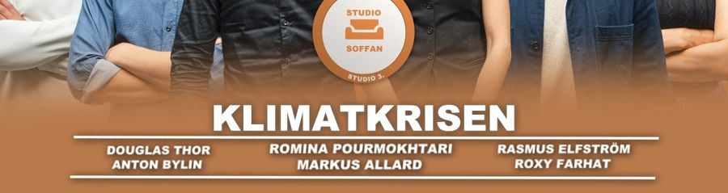
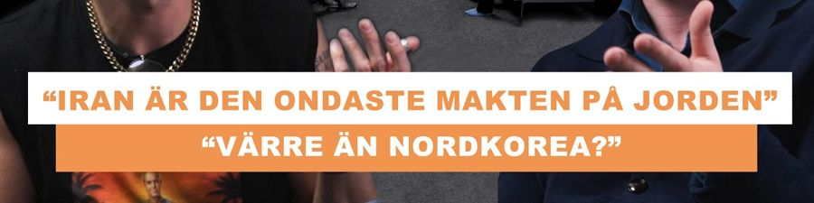
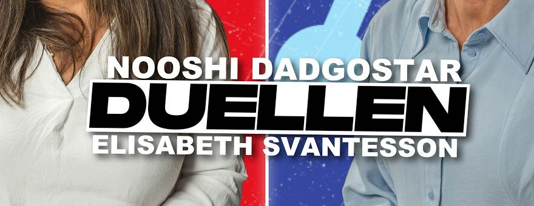
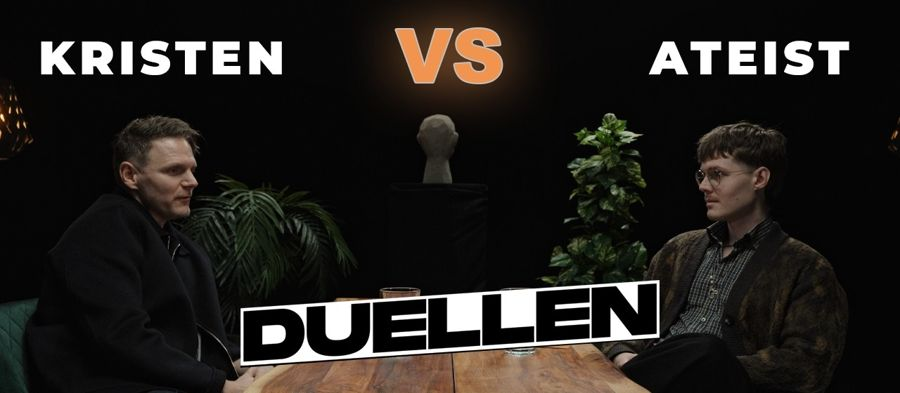
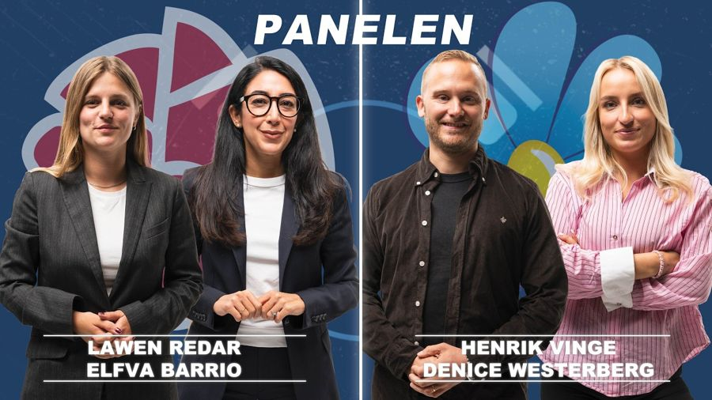
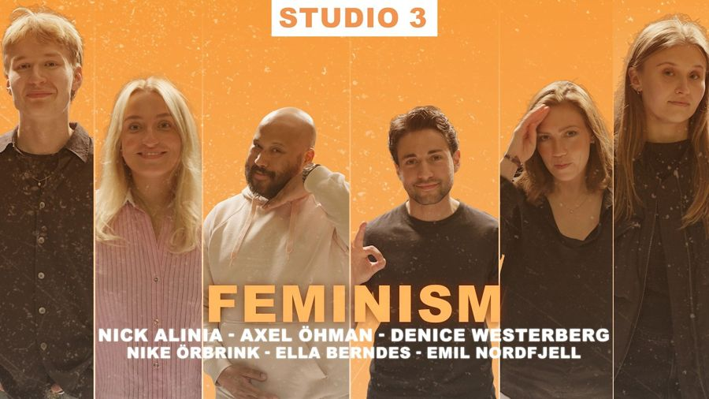

# STUDIO 3:s grafiska profil

Hämtad från kanalens thumbnails, Shorts, banner och logga på YouTube och använd på sajten i stilpaketet *Studio 3 Original*.

## Färger

| Färg | Hex | Var den syns på YouTube |
|---|---|---|
| Studio 3-orange | `#F1944F` | Loggan, citatlådor, "VS", Shorts-texter |
| Ljus orange | `#F9A447` | Bakgrund i temaavsnitt (t.ex. *Feminism*) |
| Terrakotta | `#B87A4B` → `#915F3E` | Studio Soffans tona nertill |
| Marin | `#213F63` | Panelens bakgrund |
| Studiovit | `#ECECEC` | 1 mot 20 (vit studio) |
| Svart | `#0F0F0F` | Shorts, Duellen (mörk studio) |

## Typsnitt

| Användning | På YouTube | På sajten |
|---|---|---|
| Rubriker och titlar | Tung grotesk som Arial Black ("KLIMATKRISEN") | **Archivo Black**, versaler, mjuk mörk skugga |
| Namn, etiketter, citat | Geometrisk, luftigt spärrad ("KRISTEN", citatlådor) | **Montserrat** 800, versaler |
| Loggor | Bred grotesk ("S3.", "20 VS 1") | Vektoriserade SVG-loggor |

## Element

| Element | Exempel | På sajten |
|---|---|---|
| Namnplatta: namn i versaler mellan två tunna vita linjer |  | `.nameplate` – teamet under Om oss |
| Citatlådor: vit låda med orange text, orange låda med vit text |  | `.quotebox` – citattitlar på avsnitt och påståenden på debatter |
| DUELLEN som lutande sticker |  | `.sticker` – "Söker nu" på öppna debatter |
| Orange "VS" med glöd |  | `.vs` – i alla titlar med "vs" |
| Marinblå bakgrund och vit mittlinje |  | Panelens och Duellens formatkort |
| Vit etikett med orange text och dammig, repig textur |  | `.tagbox` (formatetiketter) och `.dust` (hero, siffror, formatkort) |
| Studio Soffan-badge: vit insida, orange ring, "STUDIO 3." på ringen | (se första bilden) | `public/assets/img/logos/studio-soffan.svg` |
| Shorts: ett ord i taget i orange versaler på svart | – | Sloganen i heron kommer fram ord för ord |

Varje format har dessutom sitt eget formatkort i samma färger som formatets thumbnails: terrakotta (Studio Soffan), studiovitt (1 mot 20, Partiledare), partifärger med mittlinje (Duellen), marin (Panelen), solnedgång (Valvakan) och orange paneler (Studio Banditer).

Reservvideon i heron (`npm run hero:thumbs`) använder samma typsnitt, citatlådor och textur.
